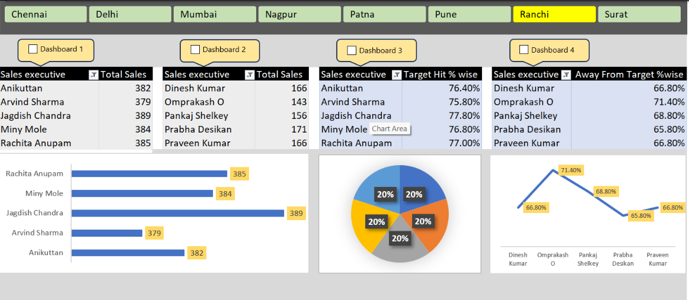

# sales-performance-dashboard-excel
Interactive Excel dashboard for analyzing sales performance, executive-wise sales, and target achievement.
# Sales Performance Analysis Dashboard

## Project Overview
An interactive Sales Performance Dashboard created using Microsoft Excel to analyze sales performance across multiple cities and evaluate individual sales executives.

## Project Objectives
- Analyze sales performance across different cities.
- Compare total sales generated by sales executives.
- Monitor target achievement percentages.
- Identify performance gaps.

## Dashboard Features
- City-wise sales analysis using interactive slicers.
- Sales executive-wise total sales comparison.
- Target Hit Percentage analysis.
- Away From Target Percentage analysis.
- Interactive charts and visualizations.

## Tools & Techniques Used
- Microsoft Excel
- Pivot Tables
- Pivot Charts
- Slicers
- Bar Charts
- Pie Charts
- Line Charts
- Data Visualization

## Project Files
- `Sales_Performance_Dashboard.xlsx` – Interactive Excel dashboard.
- `images/dashboard_preview.png` – Dashboard screenshot.

## Dashboard Preview

## Key Learnings
- Creating interactive Excel dashboards.
- Analyzing data using Pivot Tables.
- Using slicers for dynamic filtering.
- Creating meaningful data visualizations.

## Conclusion
This project demonstrates how Microsoft Excel can be used to analyze sales performance and present business insights through interactive dashboards.
